# 日常可用度批次（O）技术设计

Feature Name: daily-essential-batch
Updated: 2026-10-19
需求文档：同目录 requirements.md

## Description

四个独立小件：方控媒体键转发、专辑封面管线、配置导出/导入、崩溃记录与自恢复。全部落在现有基建上，零新权限、零第三方依赖。

## Architecture

```mermaid
graph TD
    subgraph F1
    A["方控 KeyEvent"] --> B["HomeActivity.dispatchKeyEvent 拦截"]
    B --> C["MediaKeyRouter 选会话"]
    C --> D["本地 MusicService controller 优先"]
    C --> E["远端活跃 controller"]
    D --> F["transportControls"]
    E --> F
    end
    subgraph F2
    G["MediaMetadata ALBUM_ART"] --> H["CoverCache 后台解码+256px 采样"]
    H --> I["音乐块背景/迷你播放器"]
    end
    subgraph F3
    J["prefs json_layout"] --> K["导出 meta+JSON 落 files/export"]
    K --> L["SeagullFileProvider + ACTION_SEND"]
    M["SAF 选文件"] --> N["校验 v 字段"] --> O["反解写入+bumpCfg"]
    end
    subgraph F4
    P["UncaughtException"] --> Q["CrashGuard 记录 RootLog+files/crash"]
    Q --> R["签名计数 >=3 置标记"]
    R --> S["下次启动清画布+提示"]
    end
```

## Components and Interfaces

### F1 MediaKeyRouter（新文件，~90 行）

- `static boolean handle(KeyEvent e, Context c)`：HomeActivity.dispatchKeyEvent 入口，命中 KEYCODE_MEDIA_*（PLAY/PAUSE/PLAY_PAUSE/NEXT/PREVIOUS/STOP）返回 true 吞掉，其余 false。
- 会话选择：`MediaSessionManager.getActiveSessions(ComponentName(this, MediaListenerService.class))`（Lyrics.java:181 同款，通知监听器身份已具备）。
- 目标排序：本地包名（context.getPackageName()）会话且 playbackState 为 playing/paused 时排首；否则按 active sessions 顺序取第一个。
- 动作映射：PLAY_PAUSE 按 playbackState 二分为 play/pause；其余一一对应 transportControls。
- 接线：HomeActivity.dispatchKeyEvent 在现有触摸/手势分发之前（N1 手势段之前）插一行调用。
- 反汇编约束：android.media.session.MediaSession 与 playbackState 全在桩 android.jar 内（Lyrics 已用 MediaController，同包系）。

### F2 CoverCache（新文件，~110 行）

- `static Bitmap get(String key, MediaMetadata md)`：键 = title+"|"+artist；命中直接返回。
- 解码：ALBUM_ART 位图直取；ALBUM_ART_URI 用 ContentResolver 开流 BitmapFactory.decodeStream，inSampleSize 按 256px 目标计算。
- 线程：单线程 Executor；get() 未命中返回 null，异步完成后 Lyrics/MusicBlock 下一次 tick 拿到（现有 1s tick 天然轮询，无需回调）。
- 缓存：static LruCache<Bitmap> 容量 2（当前曲 + 预解码余量），键变化即淘汰。
- MusicService 本地封面：扫描时 MediaMetadataRetriever.getEmbeddedPicture 存进本地曲数据（byte[]），构造 MediaMetadata 时 METADATA_KEY_ALBUM_ART 塞入（MusicLib 条目加 art 字段，懒提取：首次播放时提取一次并缓存到内存，不落盘）。
- 接线点：WallpaperPage.refreshMusBlock（背景遮罩层 ImageView 换封面）与 MusicActivity MiniPlayer 封面位。

### F3 ConfigPort（新文件，~130 行）

- 导出 `export(Context)`：
  1. `c.getSharedPreferences(HomeActivity.PREFS, MODE_PRIVATE).getAll()` 全键包 JSONObject（含非 json_layout 的附键，一并带走）；
  2. 外层 meta：`{ts, v:2, commit:<BuildConfig 版本串>}`（commit 号用现有 About 页同源常量）；
  3. 写 `getFilesDir()/export/seagull-config-YYYYMMDD-HHmm.json`，保留最近 5 份，旧的轮转删除；
  4. SeagullFileProvider content:// + ACTION_SEND（SettingsSectionActivity :1572 APK 更新同款链路）。
- 导入 `import(Context, Uri)`：
  1. ContentResolver 开流读文本，限 5MB；
  2. `new JSONObject(raw)` + 检查 `optInt("v")`，失败弹可读原因返回 false；
  3. 校验通过：遍历导出键，逐键写回 SharedPreferences（字符串原样存），bumpCfg()，返回 true；设置页弹「已导入，点重启桌面生效」（现成重启入口）。
- 原子性：写回在单次 editor.apply() 批提交，中途异常不留半档。
- UI 接线：SettingsSectionActivity systemBody 加 actionRow 两行「导出配置」「导入配置」，导入走 ActivityResult（复用 REQ_WALL 常量区新增 REQ_CFGIMP=0x5A14）。
- 边界：导入文件由旧版导出（缺新字段）时 LauncherModel.load() 默认值补齐语义已存在，无需额外处理。

### F4 CrashGuard（新文件，~100 行）

- `static void install(Context c)`：HomeActivity.onCreate 首行调用；包原 defaultUncaughtExceptionHandler。
- handler 内流程（全程 try-catch 包裹，自身异常静默放弃）：
  1. 拼 `时间/线程/commit/Log.getStackTraceString` 一份文本；
  2. RootLog.e(tag, msg, t)（/data/local/tmp/seagull-root.log，rotate 已有）；
  3. 写 `getFilesDir()/crash/crash-<System.currentTimeMillis()>.txt`，目录超 10 份删最旧；
  4. 签名（异常类名+首帧）计数进 SharedPreferences 键 `crash_sig`，`{sig, count, firstTs}`，24h 窗口外清零；count>=3 置 `crash_recover=1`；
  5. 委托原 handler。
- 启动恢复：HomeActivity.onCreate 检测 `crash_recover=1` → 清标记 + `model.pipDeploy 状态重置`（复用恢复出厂的画布重置子集，只动布屏键）+ Toast 一次性提示。
- 日志导出：负一屏日志卡（NegScreenView 现有导出逻辑）扩一个来源目录 files/crash/，打包含入。

## Data Models

- 导出 JSON：`{"meta":{"ts":169...,"v":2,"commit":"f16f2f3"},"keys":{"json_layout":"<全量配置字符串>",...其他 prefs 键}}`
- crash_sig 记录：`{"sig":"<类名>#<首帧>","count":n,"firstTs":ms}`
- MusicLib 曲目：新增 `byte[] art`（内存态，不持久化）

## Correctness Properties

1. F1 按键无活跃会话时走默认分发，launcher 行为与改动前逐字节一致。
2. F2 同一曲封面只解码一次（键相等短路），解码线程数恒为 1。
3. F3 导入失败时 SharedPreferences 内容零变化（先全量校验后写）。
4. F4 崩溃处理链自身抛异常不影响原 handler 执行（全包裹委托兜底）。
5. 导出→导入 round-trip 后 prefs getAll() 与导出源逐键相等（自检验证）。

## Error Handling

| 场景 | 处理 |
|---|---|
| F1 getActiveSessions 抛 SecurityException | RootLog 记录 + return false（按键走默认路由） |
| F2 URI 流关闭失败/解码 null | 缓存负结果（同键 60s 内不再尝试），UI 回落纯色 |
| F3 文件超 5MB / JSON 异常 / 缺 v | 拒绝导入，AlertDialog 给具体原因 |
| F4 files/crash 写失败（磁盘满） | 跳过文件只留 RootLog，流程继续 |

## Test Strategy

- 自检新增 `ConfigCheck`（纯 JVM）：构造含 30+ 键的样例 prefs → 走导出打包逻辑（meta 注入）→ 导入反解 → 断言逐键相等 + 破损 JSON/缺 v 两个拒绝用例。导出/导入核心逻辑抽静态纯函数（输入 JSONObject 输出 JSONObject）保证可 JVM 跑。
- 自检新增 `CrashSigCheck`：签名拼接/24h 窗口计数/阈值置位逻辑抽纯函数测 12+ 用例。
- F1/F2 依赖 Android 框架对象，自检覆盖不到的走 DEVTASKS 真机验收：方控键控本地曲与蓝牙曲、封面显示与无封面回落、换机导入。
- javac --release 11 全量 + 既有 8 项自检回归。

## References

[^1]: app/src/com/seagull/carlauncher/Lyrics.java#L181 — getActiveSessions 现有用法
[^2]: app/src/com/seagull/carlauncher/SettingsSectionActivity.java#L1572 — FileProvider 分享现有链路
[^3]: app/src/com/seagull/carlauncher/RootLog.java#L26 — 日志落档与轮转
[^4]: app/src/com/seagull/carlauncher/LauncherModel.java#L36 — 配置存储位置（PREFS/json_layout）
