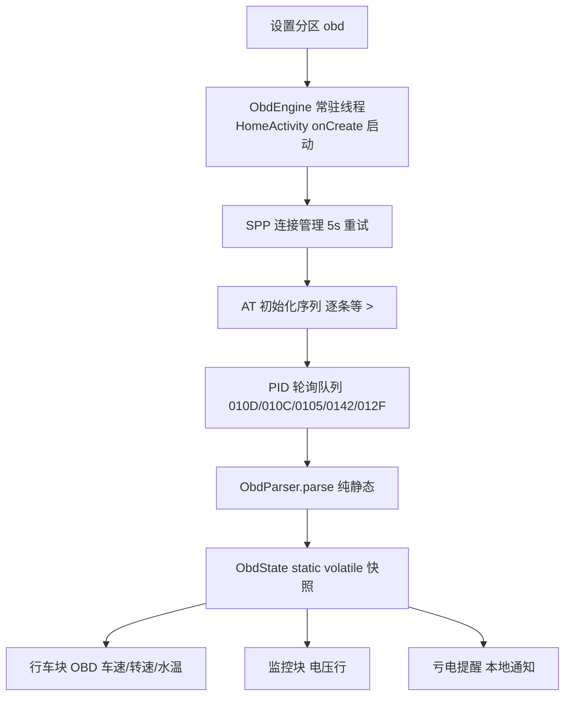

# OBD2 车辆数据（批次 P）技术设计

Feature Name: obd2-vehicle-data
Updated: 2026-10-19
需求文档：同目录 requirements.md

## Description

ObdEngine 常驻线程经 SPP 串口与 ELM327 对话：AT 初始化 → Mode01 PID 单命令轮询 → 标准公式解析 → static 快照；行车块/监控块 1s tick 自取渲染，电压低发本地通知。协议解析抽纯静态函数供 JVM 自检。

## Architecture

## Components and Interfaces

### ObdParser（新文件，纯静态，~120 行）

- `static double parse(int pid, String resp)`：按行扫描（\r/\n 分割），跳过 SEARCHING/BUS INIT/空行/NO DATA 等错误 token；找到首行以 "41" + pid 十六进制开头的数据帧后按公式换算，找不到返回 NaN。
  - 010D: `A`（km/h）
  - 010C: `(A*256+B)/4`（rpm）
  - 0105: `A-40`（摄氏度）
  - 0142: `(A*256+B)/1000`（V）
  - 012F: `A*100/255`（%）
  - ATRV 专用 `parseVoltage(String resp)`：匹配 `(\d+\.\d+)V`。
- `static boolean isError(String line)`：错误 token 判定（NO DATA/UNABLE TO CONNECT/CAN ERROR/BUS ERROR/STOPPED/BUFFER FULL/?/FB ERROR/DATA ERROR）。
- 响应清洗：去空格去冒号多帧标记（ELM headers-off 下多帧是字节数行 + 0:/1: 行，标准 5 字节 PID 不会触发多帧，扫描时跳过形如 `0:` 的行即可）。

### ObdEngine（新文件，单例线程，~260 行）

- `static void start(Context c)` / `static void stop()`：HomeActivity onCreate/onDestroy 按开关调用；线程命名 seagull-obd。
- 状态快照 `static final ObdState STATE`：`{boolean online; float speedKmh; float rpm; float coolantC; float voltageV; float fuelPct; long lastTs; boolean lowVoltWarned;}`，volatile 字段逐个写入（读取方 tick 撕裂可容忍，数值型写原子）。
- 连接循环：`BluetoothAdapter.getDefaultAdapter().getBondedDevices()` 按 LauncherModel.obdMac 过滤 → `createRfcommSocketToServiceRecord(SPP_UUID)`（00001101-0000-1000-8000-00805F9B34FB）→ connect（IOException 捕获，关 socket，5s 重试）。
- 读响应：写 `cmd + "\r"`，读流直到 '>' 或 2s 超时，攒成 String。
- 轮询：在线状态下按 model.obdIntervalMs 依次发 010D/010C/0105/0142/012F；0142 得到 NO DATA 时补发 ATRV；每轮结束检查连续全失效计数（R2.4）。
- 重连判定：IOException / 写失败 / R2.4 → 关流 → offline → 5s 后重连。
- 电压提醒：每次解析出电压，低于 model.obdVoltLow 持续 60s（首低时间戳比较）且本会话未提醒 → 发本地通知（NotificationChannel 复用现有通道，PendingIntent 进设置页）；恢复阈值以上复位。
- 配置读取：`new LauncherModel(ctx,false)`（构造器自带 load，无 clobber），每轮循环开始读一次间隔/阈值。

### 设置分区 obd（SettingsSectionActivity 新 case，~120 行）

- titleOf("obd")="车辆数据"；hub SECTIONS 加行（高级功能组，keywords 车辆数据/OBD/转速/水温/电压/电瓶/亏电/转速表）。
- obdBody()：
  - toggleRow 启用开关（model.obdEnabled）→ 变更时 ObdEngine.start/stop；
  - BLUETOOTH_CONNECT 运行时权限：未授权时开关行下挂「申请蓝牙权限」actionRow（requestPermissions 同款模式，REQ_OBD=0x5A15）；
  - 适配器选择 choiceRow：无权限/无配对设备显示可读说明；有则列 bonded devices 名字（存 model.obdMac）；
  - 间隔 choiceRow（1s/2s/5s → model.obdIntervalMs）；
  - 电压阈值 choiceRow（11.5/12.0/12.5 → model.obdVoltLow）；
  - note：头子须先在系统蓝牙里配对；点火 ON 才有数据；车速真值 vs GPS 偏差说明。
- 权限回调 onRequestPermissionsResult 加 REQ_OBD 分支 render()。

### 块接入（WallpaperPage 改造，~80 行）

- 行车块（gpsBox）：OBD 在线且 010D 有效 → 车速显示 OBD 值（后缀 kmh 不变），标题行尾加 "OBD" 角标；增示 rpm/coolant 两小行（失效显示 --）；离线时移除两行回落 GPS。
- 监控块（monBox）：在线增一行「电瓶 x.xV」，离线移除。
- 刷新点：refreshGpsBlock/refreshMonBlock 内读 ObdEngine.STATE（tick 1s 天然轮询）。

### LauncherModel 字段（4 个 + save/load 各 4 行）

- obdEnabled(boolean,默认 false)、obdMac(String)、obdIntervalMs(int 默认 2000)、obdVoltLow(float 默认 12.0f)。

### Manifest

- `<uses-permission android:name="android.permission.BLUETOOTH_CONNECT"/>`（Android 12+ 运行时）；BLUETOOTH/BLUETOOTH_ADMIN 加 maxSdkVersion="30"（旧系统静默授予）。

## Data Models

- ObdState：全 primitive 字段 + lastTs，无对象分配，tick 直读。
- LauncherModel：4 个扁平字段随既有 save/load 通道落档（音乐/主题同款）。

## Correctness Properties

1. 解析器对同一响应文本结果确定（纯函数，无状态）。
2. 同一时刻至多一条未决 ELM 命令（单线程串行队列）。
3. OBD 离线时 UI 数值与改动前逐字节一致（GPS 路径零回归）。
4. 提醒每会话至多一次（lowVoltWarned 单向闩，恢复才复位）。
5. ObdEngine 自身任何异常只降级离线，进程存活（线程内全 catch）。

## Error Handling

| 场景 | 处理 |
|---|---|
| 蓝牙关/无配对设备 | 保持离线，设置页可读原因 |
| socket connect 抛 SecurityException（权限缺失） | RootLog + 离线，设置页提示权限 |
| ATZ 无 '>'（波特率不匹配/伪 ELM） | 2s 超时判失败重连，RootLog 记录 |
| PID 连续 10 轮全失效 | 判离线重连 |
| 解析 NaN | UI 显示 --，快照字段保持上次值+失效标记 |

## Test Strategy

- 自检新增 `ObdCheck`（纯 JVM）：canned 响应喂 parse() 断言 12+ 用例（各 PID 正常值、多行含 7E8 头、SEARCHING 过渡、NO DATA、?、空串、012F 满格 255→100%、0142 13.48V 向量、ATRV "12.3V"）；isError 全 token 覆盖。
- 块 UI/连接/通知走真机验收表（配对、熄火重连、真值对比、亏电提醒）。
- javac --release 11 全量 + 既有 8 项 + ConfigCheck/CrashSigCheck 回归。

## References

[^1]: pires/obd-java-api（MIT）— 命令集与协议枚举参考
[^2]: pub.dev/packages/obd2_kit — AT 初始化序列与错误 token 清单核对
[^3]: app/src/com/seagull/carlauncher/MusicLib.java — static 快照+扫描模式先例
[^4]: app/src/com/seagull/carlauncher/SettingsSectionActivity.java#L1572 — 权限请求/设置页模式先例
