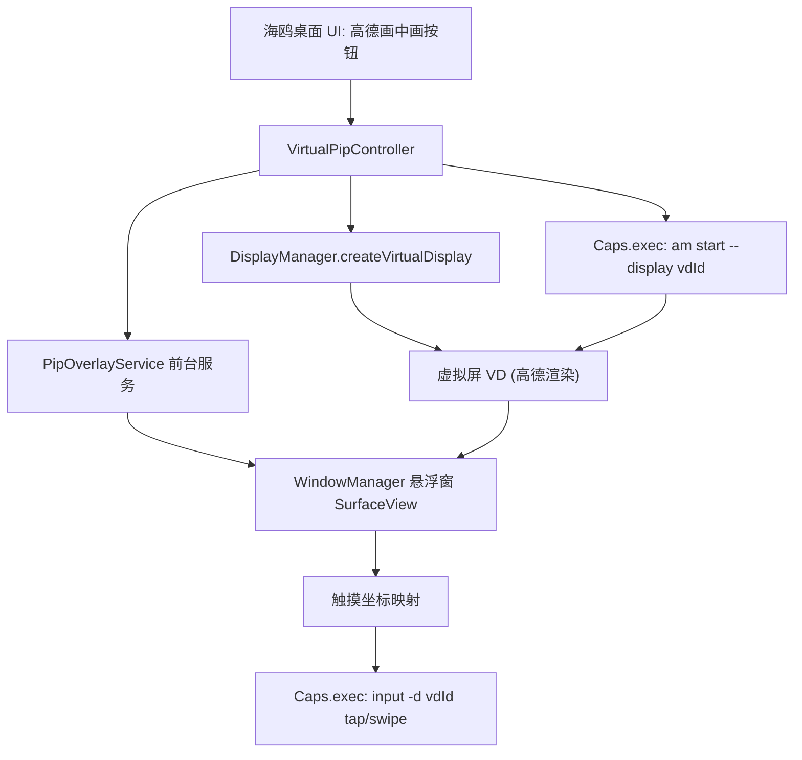

# 海鸥虚拟屏画中画（Virtual Display PiP）

Feature Name: virtual-display-pip
Updated: 2026-10-20

## Description

海鸥桌面自建 VirtualDisplay，用 root 把高德拉进虚拟屏渲染，悬浮窗（SurfaceView）呈现画面，尺寸/位置/拉伸全由海鸥控制；触摸与按键经 root input 命令按坐标映射转发。不 hook 高德、不依赖 LSPosed。

## Architecture

数据流：VD 画面经 Surface 输出到 SurfaceView；输入反向经 root shell 注入。两条链路一进一出，互不阻塞。

## Components and Interfaces

### 1. VirtualPipController（新建）

职责：虚拟屏生命周期 + 高德拉入。

- `createVd(int w, int h, int dpi): VirtualDisplay`
  - `DisplayManager.createVirtualDisplay("seagull_pip", w, h, dpi, null, VIRTUAL_DISPLAY_FLAG_PUBLIC)`
  - 分辨率来源：`DisplayManager.getDisplays()` 取非默认屏的 `getRealMetrics`，失败回退 1280x720
- `launchAmap(VirtualDisplay vd): boolean`
  - `PackageManager.getLaunchIntentForPackage(pkg)` 解析 launchable 组件名
  - `Caps.exec("am force-stop <pkg>; am start --display " + vd.getDisplay().getDisplayId() + " -n <component>")`
  - 默认 pkg = com.autonavi.amapauto（可在设置切换 com.autonavi.minimap）
- `releaseVd()`

### 2. PipOverlayService（新建，前台服务）

职责：悬浮窗渲染 + 输入转发。

- WindowManager.LayoutParams(TYPE_APPLICATION_OVERLAY, FLAG_NOT_FOCUSABLE) 挂 SurfaceView
- SurfaceView 持有 VD 的 Surface（`vd.setSurface(sv.getHolder().getSurface())`）
- 拖动：TouchSlop 区分拖动与点击，拖动改 LayoutParams x/y
- 预设切换：重算 LayoutParams width/height（60% 短边 / MATCH_PARENT / 自定义比例），VD 分辨率不动
- 触摸转发：`x' = x * vdW / viewW`，单击转 `input -d <id> tap`，滑动转分段 `input -d <id> swipe x1 y1 x2 y2`（约 3~5 段）
- 通知栏常驻（FOREGROUND_SERVICE，已有权限 FOREGROUND_SERVICE_SPECIAL_USE）

### 3. 复用

- `Caps.exec`：root 命令通道（已有）
- `SysOps`：已有的 am/display 命令工具（新增 `inputOnDisplay` 通用封装）
- `Skin/R/color`：UI 风格沿用

## Data Models

SharedPreferences（已有存储）新增键：

| 键 | 类型 | 默认 |
|---|---|---|
| pip_pkg | String | com.autonavi.amapauto |
| pip_preset | String | short60 |
| pip_custom_ratio | float | 1.7778 |
| pip_kill_on_close | boolean | false |
| pip_last_x / pip_last_y | int | 屏幕右下区域 |

## Correctness Properties

1. VD displayId 在悬浮窗生命周期内恒定
2. 悬浮窗关闭后 VD 必被 release（防止虚拟屏泄漏堆积）
3. 触摸坐标映射误差不超过 1 VD 像素
4. 同一时刻最多一块海鸥虚拟屏
5. VD 分辨率在会话内不变，尺寸切换只动视图层

## Error Handling

| 场景 | 处理 |
|---|---|
| createVirtualDisplay 返回 null | 日志区显示原因，按钮回到可点状态 |
| am start 退出码非 0 或 8 秒无帧 | 提示「高德未落入虚拟屏」+ 重试按钮 |
| input 命令连续 3 次失败 | 停止转发，提示 root 通道异常 |
| pidof 车机高德为空 | 提示疑似远端投屏，方案不可用 |
| 悬浮窗权限缺失 | 引导授权 SYSTEM_ALERT_WINDOW（已声明） |

## Test Strategy

车机实测清单：

1. 三预设切换即时生效且画面清晰（VD 分辨率不重采样）
2. 拖动流畅，松手位置持久化
3. 点击命中验证：点高德「搜索」图标，高德内弹出搜索页（证明映射正确）
4. 返回键注入后高德回退
5. 关闭悬浮窗后 `dumpsys display` 中 VD 消失
6. 与现有 LSPosed hook 并存开关互不影响
7. 高德进程不在本机时的降级提示

## References

- 需求文档: requirements.md（同目录）
- 既有 root 通道: app/src/com/seagull/carlauncher/Caps.java
- 既有 display 命令: app/src/com/seagull/carlauncher/SysOps.java
